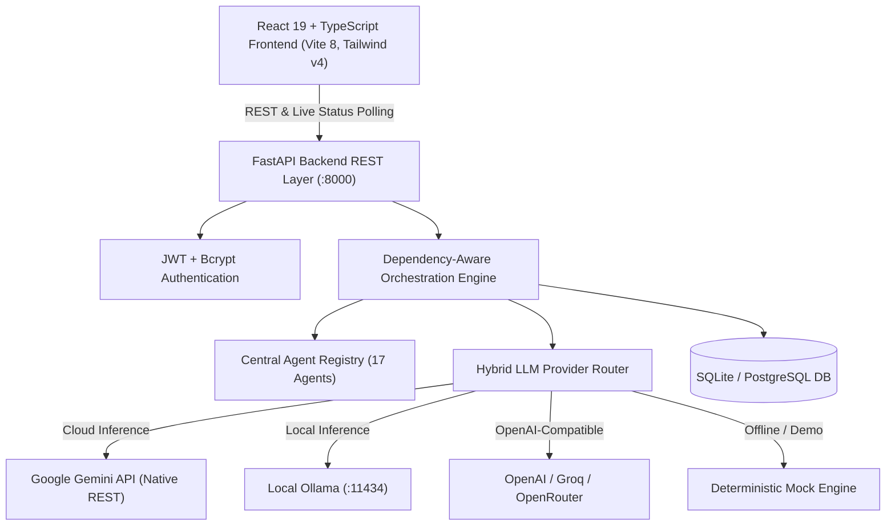
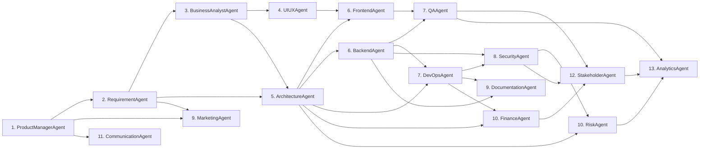

# PMPilot - Autonomous 17-Agent SDLC Orchestration Platform

PMPilot is a full-stack, enterprise-grade multi-agent project management and software development lifecycle (SDLC) system. It orchestrates a collaborative collective of **17 specialized AI agents** that iteratively transform high-level requirements into production-ready software artifacts, architecture decision records (ADRs), risk registers, automated test suites, and compliance audits.

Unlike simple chatbots, PMPilot models the entire engineering team: decomposing tasks along a dependency-aware Directed Acyclic Graph (DAG), persisting state to a relational database, providing human-in-the-loop governance checkpoints, and supporting both cloud and local on-device LLMs.


> [!TIP]
> **Looking for a quick start?** See the step-by-step [RUN_INSTRUCTIONS.md](file:///d:/SEM%207/Arti-Intel/AI/RUN_INSTRUCTIONS.md) for launch commands, live testing, troubleshooting, and agent verification.

---

## Architecture Overview



### Execution Modes
- **Autonomous Mode**: The orchestration engine resolves the dependency DAG and runs all 17 agents across all phases without human intervention.
- **Human-in-the-Loop (HITL) Review Mode**: Pauses execution at critical architectural governance gates (`ArchitectureAgent` ADR signoff, `SecurityAgent` threat model approval), allowing team leads to inspect deliverables, provide feedback, or approve continuation.

---

## The 17-Agent SDLC Collective

The system executes 17 distinct agent personas organized into sequential and parallel execution phases:



| Phase | Agent ID | Role | Key Output Deliverables |
| :---: | :--- | :--- | :--- |
| **1** | `ProductManagerAgent` | Central SDLC Orchestrator | Master SDLC Roadmap, Milestone Schedule |
| **2** | `RequirementAgent` | Specification Architect | IEEE 830 FR/NFR Specification, MoSCoW Matrix |
| **3** | `BusinessAnalystAgent` | Backlog & Epic Decomposer | Agile Backlog, Gherkin Scenarios, Story Points |
| **4** | `UIUXAgent` | Design Systems Architect | WCAG 2.1 AA Tokens, Wireframe Layouts |
| **5** | `ArchitectureAgent` | Distributed Systems Architect | ADR-001 Architecture Record, Topology Diagram |
| **6** | `FrontendAgent` | Client SPA Developer | React State Client, UI Component Manifest |
| **6** | `BackendAgent` | API & Database Architect | Relational SQL Schema, Service Controllers |
| **7** | `QAAgent` | Test Automation Engineer | Automated Test Suites, Locust Load Scripts |
| **7** | `DevOpsAgent` | Cloud Infra & CI/CD Architect | Dockerfile, docker-compose.yml, CI Workflows |
| **8** | `SecurityAgent` | Threat Modeler & Auditor | STRIDE Threat Model, OWASP Audit Report |
| **9** | `DocumentationAgent` | Technical Author | OpenAPI 3.0 Spec, Developer Runbooks |
| **9** | `MarketingAgent` | GTM & Growth Strategist | GTM Launch Blueprint, TAM/SAM/SOM Model |
| **10** | `FinanceAgent` | TCO & Budget Controller | TCO Financial Model, 3-Year ROI Forecast |
| **10** | `RiskAgent` | Risk Governance Officer | 5x5 Likelihood vs Impact Risk Heatmap |
| **11** | `CommunicationAgent` | Message Broker & Auditor | Inter-Agent Event Bus Audit Log |
| **12** | `StakeholderAgent` | Executive Gatekeeper | Production Release Authorization |
| **13** | `AnalyticsAgent` | Product Health Indexer | 0-100 Product Health Scorecard, KPI Radar |

---

## Technology Stack

- **Frontend**: React 19, TypeScript, Vite 8, Tailwind CSS v4, Lucide Icons
- **Backend**: FastAPI, Uvicorn, Pydantic v2
- **ORM & Persistence**: SQLAlchemy 2.0, SQLite (default) / PostgreSQL
- **Security**: Bcrypt password hashing, PyJWT bearer token authentication
- **Testing**: Pytest, Pytest-Asyncio, HTTPX TestClient, Oxlint
- **LLM Integrations**: Google Gemini (native REST API), Ollama, OpenAI-compatible APIs, Deterministic MockProvider
- **Exporting**: Python-Docx (Word reports), Markdown, HTML, CSV, JSON

---

## Environment Configuration

Copy `.env.example` to `.env`:

```bash
cp .env.example .env
```

| Variable | Description | Default |
| :--- | :--- | :--- |
| `DATABASE_URL` | Database connection string | `sqlite:///./pmpilot.db` |
| `JWT_SECRET` | Secret key for JWT signatures | `super-secret-pmpilot-jwt-key...` |
| `LLM_PROVIDER` | Active provider: `mock`, `gemini`, `ollama`, `openai_compat` | `mock` |
| `GEMINI_API_KEY` | Native Google Gemini API key | *(empty)* |
| `GEMINI_MODEL` | Gemini model name | `gemini-3.1-flash-lite` |
| `OLLAMA_BASE_URL` | Local Ollama endpoint | `http://localhost:11434` |
| `OLLAMA_MODEL` | Ollama model tag | `llama3.2` |
| `OPENAI_API_KEY` | OpenAI-compatible key (Groq, OpenRouter, DeepSeek, OpenAI) | *(empty)* |
| `OPENAI_BASE_URL` | OpenAI-compatible base URL | `https://api.openai.com/v1` |
| `OPENAI_MODEL` | OpenAI-compatible model name | `gpt-4o-mini` |
| `HOST` / `PORT` | Backend host & port | `127.0.0.1` / `8000` |

---

## Quickstart & Installation

For full instructions, see the dedicated [RUN_INSTRUCTIONS.md](file:///d:/SEM%207/Arti-Intel/AI/RUN_INSTRUCTIONS.md).

### 1. Backend Setup

```bash
# Install Python dependencies
pip install -r backend/requirements.txt

# Start FastAPI backend server
python -m uvicorn backend.app.main:app --host 127.0.0.1 --port 8000 --reload
```

The backend automatically creates database tables and seeds demo accounts and projects:
- **Project Manager**: `manager@pmpilot.ai` / `admin123` (Owner of pre-seeded end-to-end SDLC projects)
- **Administrator**: `admin@pmpilot.ai` / `admin123`
- **Demo User**: `demo@pmpilot.ai` / `password123`
- **Interactive API Docs (Swagger UI)**: `http://127.0.0.1:8000/docs`

### 2. Frontend Setup

```bash
# Install Node dependencies
npm install

# Start Vite dev server
npm run dev
```

Open `http://localhost:5173/` in your browser.

---

## Running Automated Tests & Code Quality

```bash
# Run backend test suite (Auth, Projects, Orchestrator, Providers, Metrics)
python -m pytest backend/tests -v

# Run frontend production build & typecheck
npm run build

# Run frontend linter
npm run lint
```

---

## REST API Reference

### Authentication
- `POST /api/auth/register` — Create a new user account
- `POST /api/auth/login` — Authenticate and receive JWT bearer token
- `GET /api/auth/me` — Retrieve active profile

### Projects
- `POST /api/projects` — Create project
- `GET /api/projects` — List user projects
- `GET /api/projects/{id}` — Fetch project details
- `PUT /api/projects/{id}` — Update project metadata
- `DELETE /api/projects/{id}` — Delete project and cascade data

### Agent Runs & Execution
- `POST /api/projects/{id}/runs` — Trigger a 17-agent orchestration run (`auto_approve: true|false`)
- `GET /api/projects/{id}/runs` — List runs for a project
- `GET /api/runs/{id}` — Fetch run status, progress, and execution logs
- `POST /api/runs/{id}/approve` — Approve a Human-In-The-Loop checkpoint (ArchitectureAgent / SecurityAgent)
- `POST /api/runs/{id}/reject` — Reject a checkpoint and halt run cleanly
- `POST /api/runs/{id}/cancel` — Cancel an active run
- `GET /api/runs/{id}/agents` — Real-time execution states for all 17 agents
- `GET /api/runs/{id}/export?format=docx|markdown|html|json|csv` — Export empirical execution records, reports, and deliverables

### Deliverables & Metrics
- `GET /api/projects/{id}/deliverables` — Retrieve generated code, schemas, and specifications
- `GET /api/deliverables/{id}` — Retrieve deliverable content
- `GET /api/runs/{id}/metrics` — Calculate completion rate, latency, tokens, and retries
- `GET /api/projects/{id}/metrics` — Calculate longitudinal project health across runs

---

## Academic Benchmark & Metrics Tracking

PMPilot computes real performance metrics from database-stored executions:
- **Completion Rate (%)**: Proportion of agents successfully producing valid artifacts
- **Failure Rate (%)**: Unmet dependencies or execution exceptions
- **Latency (ms)**: Per-agent and end-to-end execution durations
- **Output Completeness (%)**: Verification of findings, recommendations, and deliverables
- **Total Retries & Tokens**: Quantitative audit telemetry for empirical evaluation

